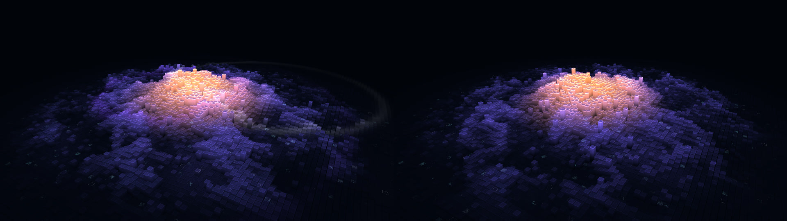
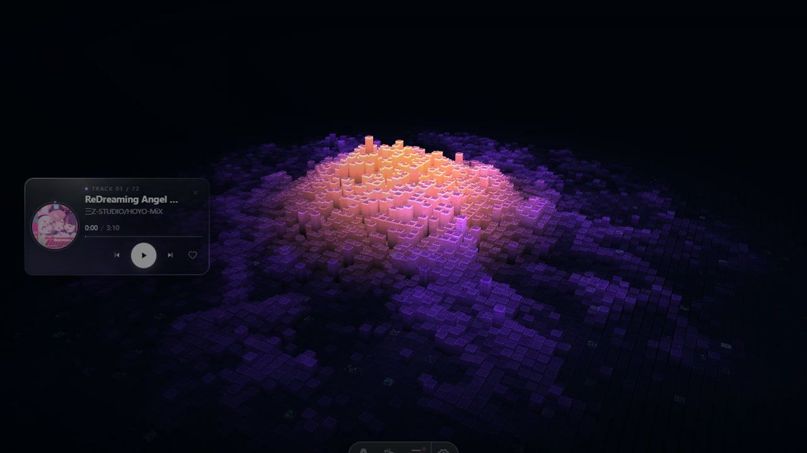

# 音域回响 · Sonic Topography（复刻）

以博客 `MusicVisualizer` 的音频响应理论为基础，对本机 Wallpaper Engine 壁纸
《音域回响 / Sonic Topography》（workshop `3747222633`）做的一比一复刻。
零依赖、零构建，WebGL2 单页；同时可作为 WE web 壁纸直接加载。



## 结论先行

| 层 | 保真度 | 说明 |
|---|---|---|
| 地形/材质 GLSL | **逐字一致** | 归一化后 5475 / 3804 字符完全相同（仅补 precision 与 attribute 声明） |
| 15 套主题 + 浅色调色板 | **逐值一致** | 8 个颜色通道 + 发光强度，误差 0 |
| 39 项配置 | **逐项一致** | 键名、默认值、min/max/step、combo 选项全部对齐 `project.json` |
| 音频下游（512 划分、8 段、音色、触发、包络） | **逐行移植** | 1 ms 节拍、Auto Beat 通量检测、涟漪/流星参数同源 |
| 相机、几何、涟漪/流星/粒子、播放器面板 | **同参数** | fov 45 / dist 85 / 120° / 25°；168 世界单位、0.857 间隙 |
| 浏览器音频输入 | **近似（唯一）** | WE 宿主模式直接吃 128 band，完全同源；浏览器模式用 WebAudio 复刻 64+64 分频 |
| 4096² 渲染精度 | **受限** | 约 1 GB 实例缓冲，浏览器会崩溃；4096 选项保留但拒绝启用 |

多帧对照（关流星以隔离特效，各 10 帧，1280×720）：

| 指标 | 原壁纸中位 | 复刻中位 | 偏差 |
|---|---|---|---|
| 平均亮度 | 0.0847 | 0.0851 | +0.5% |
| 亮区 P90 | 0.2040 | 0.2089 | +2.4% |
| 亮区占比 >0.25 | 8.02% | 8.10% | +1.0% |
| 琥珀像素 | 1.715% | 1.750% | +2.0% |
| 高亮 >0.45 | 4.44% | 4.23% | −4.7% |

单帧开启流星时 P90 会高出 10–18%，已定位为 SwiftShader 2.5 fps 下逐帧频谱通量被放大，
导致流星触发更密；真实 60 fps 下通量小一个数量级，不会出现该偏差（见 `docs/FIDELITY.md`）。

## 运行

```bash
cd wallpaper/sonic-topography
node tools/serve.mjs 5178
# 打开 http://127.0.0.1:5178/
```

没有 `npm install`，没有打包步骤。需要支持 WebGL2 的 Chromium / Firefox / Safari 16+。

参数直达：`http://127.0.0.1:5178/?panel=1&stats=1`
纯净截图：`?ui=0`；固定步长：`?fixed=1`；强制网格/主题：`?grid=320&theme=golden-hour`。

## 音频源

右下角「音频」或按 `A`：

| 源 | 说明 |
|---|---|
| 系统音频 | `getDisplayMedia` 回环；共享窗口时勾选「分享音频」。最接近 WE 的输入 |
| 麦克风 | 单声道直接双接，左右分析器同源 |
| 内置示例曲 | 24 秒程序化底鼓/贝斯/铺底/踩镲，带 ID3 标题与封面，用于验证完整链路 |
| 本地音频文件 | 支持 MP3/FLAC/WAV/OGG/M4A；解析 ID3v2 标题、艺术家、APIC 封面 |
| 演示信号 | 128 BIN 合成频谱（128 BPM 四踩），无音源权限时也能看到完整响应 |
| 静音 | 约 1 秒后进入空闲波浪 |

## 交互

- 点击空白处：空闲时触发流星（与原壁纸一致的 `meteorClickEnabled` 门控）
- `P`：参数面板；`A`：音频源；`H`：性能 HUD；`Esc`：关闭面板
- 参数面板包含 39 项 WE 属性 + 帧率上限；自动持久化到 localStorage
- 「导出 WE 配置」输出 `{key:{value}}` 格式，可直接回灌原壁纸或本复刻
  （`window.wallpaperPropertyListener.applyUserProperties`）

## 嵌入博客全屏层



博客的 `MusicVisualizer.astro` 在生产全屏层通过同源 iframe 加载本复刻：

- URL：`/lab/sonic-topography/index.html?embed=1&ui=0&stim=bridge&theme=nocturnal&grid=160`
- 父层 → iframe：`{type:"active"}`、`{type:"bands", data:Number[128]}`（30Hz）
- iframe → 父层：`{type:"ready"}`、`{type:"poke"}`、`{type:"pointer"}`、`{type:"key"}`
- `embed=1` 隐藏本复刻自己的播放器/参数/HUD，只保留场景；卡片与传输控件仍由博客组件负责
- 镜像：`node scripts/sync-sonic-lab.mjs`（`dev`/`build` 已自动执行）

这条路径让「场景、相机、音频下游、涟漪/流星、空闲节奏」与参考完全同源；
唯一被适配的是输入：博客的 256 段显示频谱先反演 `shapeBin`，再重采样成
64 段 × 2 的 WE 布局。

## 参数与配置

`project.json` 是可直接导入 Wallpaper Engine 的 web 工程描述：39 项属性、
`audio.enabled`、`supportsaudioprocessing`、`preview.jpg` 均为本复刻自带。
在 WE 中加载时：

- `wallpaperRegisterAudioListener` 的 128 个原始值直接进入下游，**不做任何浏览器分析**
- `wallpaperPropertyListener` 应用 WE 属性
- `wallpaperRegisterMedia*` 提供曲名/艺术家/封面/播放状态/进度
- `wallpaperReady()` 在初始化完成后回调

因此 **同一份代码在 WE 内是“同源输入”，在浏览器内是“仿宿主输入”**。

## 目录

```
index.html            页面骨架 + WE 媒体回调
styles.css            播放器/参数面板/HUD 样式
src/
  main.js             启动、主循环、宿主接线、参数应用
  renderer.js         实例化柱阵、相机、三个绘制通道
  shaders.js          地形 vs/fs（逐字）、流星/粒子 basic 着色器
  themes.js           15 套色板 + 明暗模式 + 色彩空间转换
  audio.js            源管理、64+64 分析、512 度量、触发、空闲波浪
  effects.js          20 槽涟漪、40 流星、200 粒子、点击射线
  player.js           磨砂播放器面板（三档尺寸、换曲动效、进度）
  properties.js       39 项属性 schema、面板、持久化、WE 配置导入导出
  glutil.js           程序/uniform 缓存、mat4、盒体几何
assets/demo-track.mp3 内置示例曲（程序化生成，含封面与 ID3）
tools/
  serve.mjs           零依赖静态服务器
  capture.mjs         复刻端无头取帧（同一条 128 band 刺激）
  ref-shot.mjs        原壁纸无头取帧（可注入主题/浅色/网格）
  compare.py          亮度分位、分区、亮区重心、暖色占比
docs/                 对照图与保真度报告
```

## 性能

- 默认 160² = 25,600 实例，一次 `drawElementsInstanced`，921,600 索引
- 音频度量固定 1 ms 节拍（512 bin 扫描 + 两个触发窗口），约 1 M 次算术/秒
- 峰值档 320² = 102,400 实例；SwiftShader 软光栅 0.6 fps，真实 GPU 可 60 fps
- 640² / 1080² 可运行但显存占用 26 MB / 74 MB；4096² 被显式拒绝（约 1 GB）
- 像素比默认 `min(devicePixelRatio, 2)`；`?dpr=1` 可固定

## 已知差异

1. **浏览器音频前端**：WE 不公开精确分频。本实现按官方「左 64 + 右 64」布局 +
   社区实测的指数分频（首段 0–35 Hz、约 7.3 段/倍频程、上限 16 kHz）复刻，
   并对 WebAudio 窗函数做 14 dB 固定补偿。宿主模式下此层被完全绕过。
2. **4096²**：配置项保留，但浏览器实例缓冲上限使其不可用；原壁纸同样会耗尽显存。
3. **WE 媒体面板**：只有存在媒体元数据时显示；系统音频/麦克风没有元数据，面板隐藏
   （与原壁纸一致）。
4. **CSS 背景**：原实现只在主题 state 变化时更新（轮询按 1 秒步进，800 ms 过渡）；
   本实现同节奏，不是逐帧渐变。

详细取证、逐项比对与 A/B 方法见 [`docs/FIDELITY.md`](docs/FIDELITY.md)。
